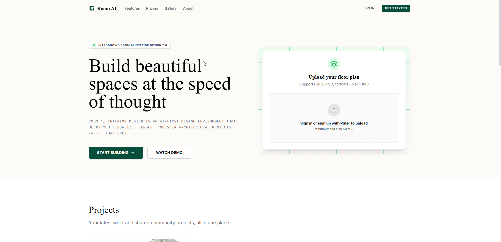
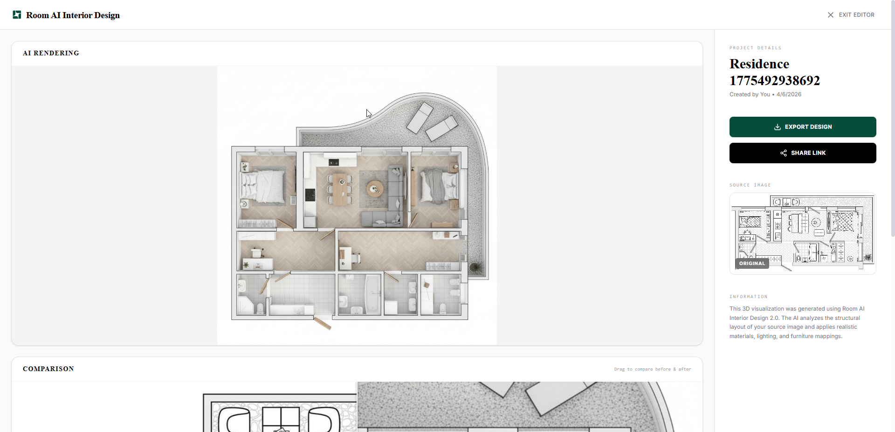
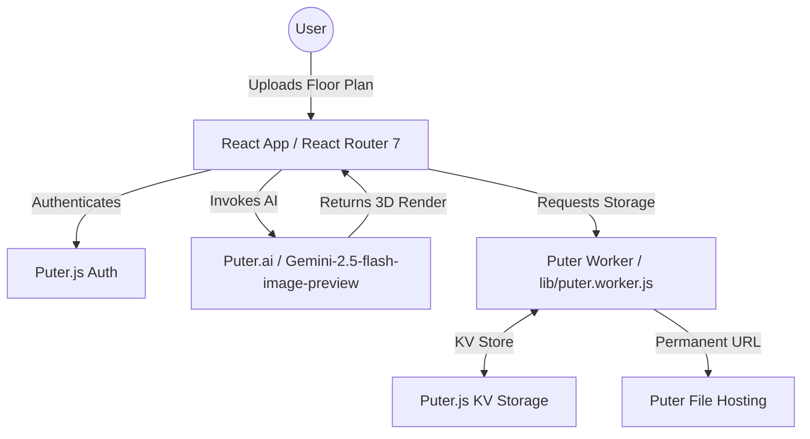

#  Room AI Interior Design

Room AI Interior Design is an AI-powered architectural visualization application that transforms 2D floor plans into photorealistic 3D renders. Built on the [Puter.js](https://puter.com) ecosystem, it offers a seamless, cloud-native experience for architects and designers.

## 🚀 Live Demos


_Modern, responsive landing page with split-hero layout._


_Professional editor-style visualizer with sidebar and comparison slider._

> [!NOTE]
> **PWA Support**: Room AI includes a complete set of favicons and a `site.webmanifest`, making it ready to be installed as a Progressive Web App on mobile and desktop.

## 🏗️ Architecture



## 🛠️ Installation & Setup

Follow these steps to get the project running locally:

### 1. Prerequisites

- [Node.js](https://nodejs.org/) (v18 or higher)
- [pnpm](https://pnpm.io/) (Recommended for faster installs)
- A [Puter](https://puter.com) account

### 2. Clone the Repository

```bash
git clone https://github.com/lwshakib/room-ai-interior-design.git
cd room-ai-interior-design
```

### 3. Install Dependencies

```bash
pnpm install
# or
npm install
```

### 4. Set Up Environment Variables

Create a `.env` file in the root directory and add your Puter Worker URL:

```env
VITE_PUTER_WORKER_URL="https://your-worker-name.puter.work"
```

## 🏃 How to Run

### Development Mode

Start the development server with Hot Module Replacement (HMR):

```bash
pnpm dev
# or
npm run dev
```

Open [http://localhost:5173](http://localhost:5173) in your browser.

### Production Build

Build the application for production:

```bash
pnpm build
# or
npm run build
```

## 🤝 Contributing

We welcome contributions! Please see [CONTRIBUTING.md](./CONTRIBUTING.md) for details on our workflow, including how to set up your own Puter Worker for development.

---

Built with ❤️ for architects and designers.
